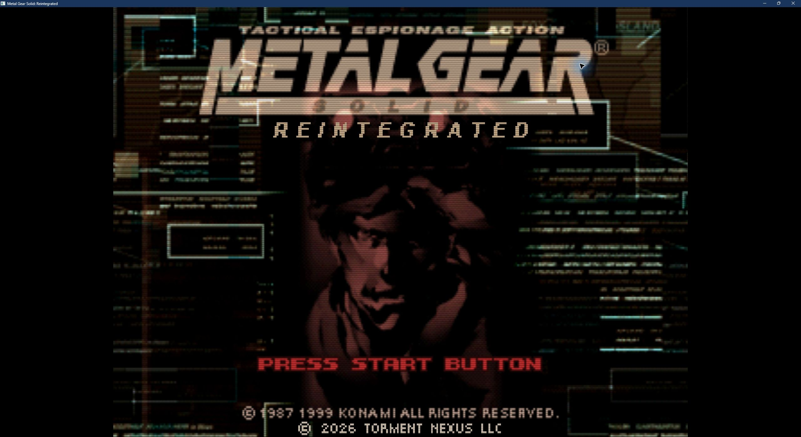

# Metal Gear Solid: Reintegrated


An experimental fork of [RE:INTEGRAL](https://github.com/Drommedhar/mgs-reintegral)
focused on portability and optional enhancements for PlayStation **Metal Gear Solid Integral**.
It builds on RE:INTEGRAL, FoxdieTeam recovered
C, and PsyZ. This repository preserves RE:INTEGRAL history and its license notices.

The current playable recovered-code runtime targets **Windows x86 (32-bit)**.
Windows/Linux x86-64 and ARM64 are portability goals. Selected component fixtures
have executed on x86-64 and emulated ARM64; full 64-bit recovered-game execution
is not established. The earlier hybrid project is a separate foundation.

New launcher profiles enable Psycho Mantis's **Installed games** memory reading.
It checks local file and folder names within bounded search roots and uses four
verified Integral dialogue references: Suikoden, Azure Dreams / Other Life,
Castlevania: Symphony of the Night, and Vandal Hearts. Off, random and numeric
seed modes remain available, and saved explicit choices are preserved. No game
or save contents are read; Steam library configuration is read only for paths.
Generic Castlevania / Other Life names are heuristic aliases for those lines.

## Download

[Experimental Windows x86 prerelease](https://github.com/ImperishableNEET/mgs1-reintegrated/releases/tag/v0.2.0-reintegrated.2)
— download windows-x86.zip, extract the folder, and open MGS-Reintegrated.exe.
Supply your own Integral CUE/BIN discs. This is a 32-bit Windows build; review
the release notes for verification limits.

## Build and play



Title-screen capture from our Windows candidate with optional scanlines enabled.

Use PowerShell 7, Python 3.11+, Git, and Visual Studio C++/Clang x86 tools plus a
Windows SDK. See [upstream setup details](docs/UPSTREAM_README.md#build).

```powershell
./tools/setup.ps1
./tools/build.ps1 -Configuration RelWithDebInfo -RendererModule renderers/modern
./Play.ps1 -Disc 'D:/Games/Integral/disc1.cue' -Scanlines
```

The Play.cmd and Play-Scanlines.cmd shortcuts prompt for a Disc 1 CUE on first use.
They remember its path locally. English text and captions are enabled at startup;
loading a save can restore its stored options. Settings and saves use
`%LOCALAPPDATA%/MGS-Reintegrated`; original discs are read in place.
A Disc 2 path can be supplied with `-DiscTwo`. No private postboss save is bundled.

Optional scanlines and cosmetic title branding affect presentation. Scanlines
remain under visual review. Xbox Elite Series 2 and DualSense Edge were manually
checked in an earlier candidate, including hot swapping; that is not a guarantee
for every connection mode. Hold Triangle for Codec dialogue turbo, enabled by default in user launchers.
Disable it in the GUI Gameplay tab or use `-CodecTurbo:$false` with Play.ps1.
Direct engine/validation launches retain original behavior without the option.

## Local assets and provenance

No game disc images, extracted game files, BIOS, commercial SDK, or private saves
are included. [Disc import](docs/DISC_IMPORT.md) documents the existing local
extractor. Imported content is for tools; the runtime currently still reads CUE/BIN.
Do not mistake extracted content support for a directory-backed runtime.

[Checkpoint and limitations](docs/REINTEGRATED_STATUS.md) |
[Fork workflow](docs/FORK_WORKFLOW.md) | [Third-party notices](docs/THIRD_PARTY.md) | [License scope](LICENSE)

Upstream records remain historical upstream evidence. They must not be read as
independent Reintegrated verification. Small native fixes are intended to remain
reviewable for contribution upstream. No affiliation with Konami is implied.
