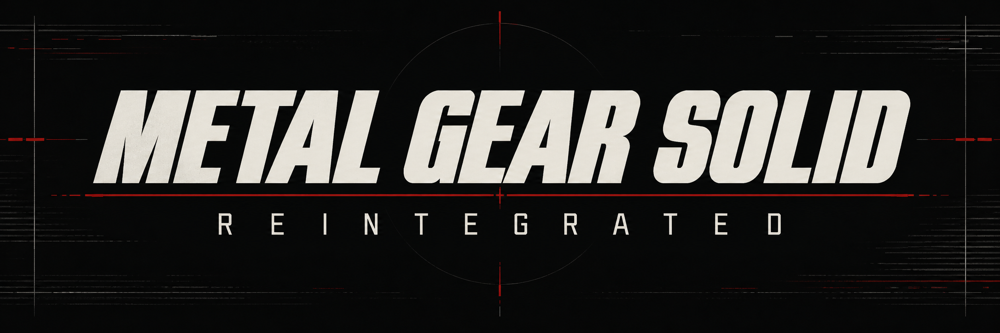
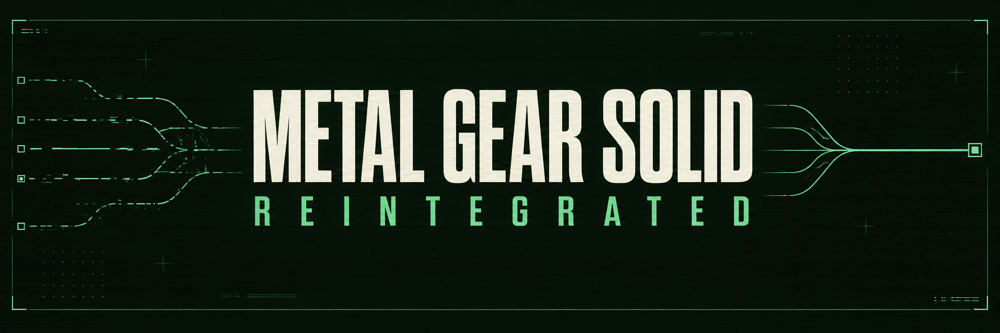

# Reintegrated README banners

Two generated title treatments, each 2048 x 683 pixels. The tactical variant is
currently used in the main README; the Codec variant is an alternative.

## Tactical — black, ivory and red

## Codec — green phosphor and reconnecting paths

Created using the built-in image-generation tool. Exact prompts are preserved in
[reintegrated-prompts.json](reintegrated-prompts.json). These are generated fan-project
branding, not screenshots or official Konami artwork. Existing upstream branding
has been retained separately. Inspected both for spelling, composition and legibility.
